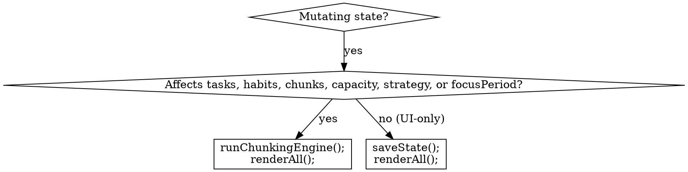
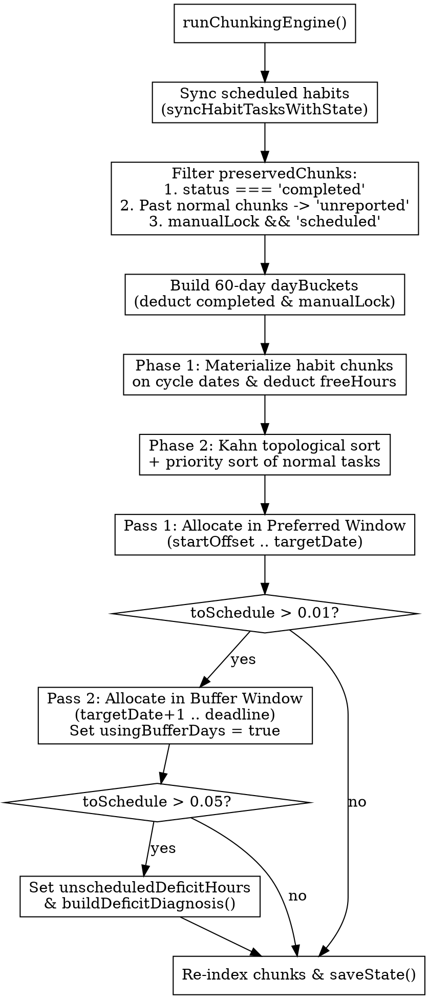
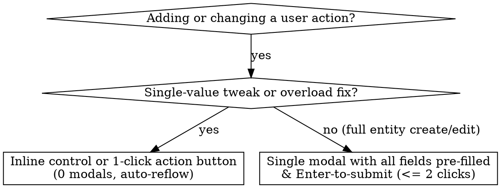

# AGENTS.md — Coding Agent Instructions for Cadence

## Overview

**Cadence** is a zero-dependency, client-side **Capacity-Based Task & Habit Planner** built with vanilla HTML, CSS, and JavaScript.

**Core principle:** Daily available time is a finite capacity pool. Tasks are sliced into manageable sessions (`chunks`) across days leading up to each task's target completion date (`deadline - bufferDays`). When work cannot fit, Cadence never silently drops hours—it computes `unscheduledDeficitHours` and explains why. Every view and workflow must stay **instantly readable at a glance** and require the **minimum possible button presses** to create, update, or log a task.

**Violating the letter of the rules is violating the spirit of the rules.**

---

## 1. Quick Reference

| Operation | Required Action / Function | File |
| :--- | :--- | :--- |
| **Today's date string (`YYYY-MM-DD`)** | `getTodayStr()` | `js/utils.js` |
| **Parse `YYYY-MM-DD` to local `Date`** | `parseDateLocal(dateStr)` | `js/utils.js` |
| **Add/subtract calendar days** | `addDays(dateStr, n)` / `diffDays(startStr, endStr)` | `js/utils.js` |
| **Monday of a date's week** | `getMondayOfWeek(dateStr)` | `js/utils.js` |
| **Resolve a day's capacity pool** | `getDailyCapacityInfo(dateStr)` | `js/state.js` |
| **Override/reset single-day hours** | `setDayOverride(dateStr, hrs)` / `clearDayOverride(dateStr)` | `js/state.js` |
| **Compute task hours & % buffer** | `getTaskHoursMetrics(task)` | `js/scheduler.js` |
| **Target completion date** | `getTargetCompletionDate(task)` (`deadline - bufferDays`) | `js/utils.js` |
| **Mutate schedule-affecting state** | `runChunkingEngine(); renderAll();` | `js/scheduler.js`, `js/render.js` |
| **Mutate UI-only state (tabs/theme)** | `saveState(); renderAll();` | `js/state.js`, `js/render.js` |
| **Sanitize dynamic HTML strings** | `escapeHtml(str)` | `js/utils.js` |
| **Verify JS syntax before commit** | `/System/Library/Frameworks/JavaScriptCore.framework/Versions/Current/Helpers/jsc` | CLI |

---

## 2. Architecture & File Map

Cadence runs directly in the browser without a bundler or build step. Scripts load sequentially in `index.html` and share the global scope:

| File | Responsibility |
| :--- | :--- |
| `index.html` | App shell, 3 views (`#view-today`, `#view-forecast`, `#view-stats`), and 4 modals (`#modal-task`, `#modal-capacity`, `#modal-checkin`, `#modal-edit-chunk`). |
| `styles.css` | Design tokens (Light & Dark themes via `[data-theme="dark"]`, `--heat-0..4`), layout grids, capacity meters, weekly visualizer cards, and analytics charts. |
| `js/utils.js` | Storage constants (`STORAGE_KEY`, `SECTIONS_BACKUP_KEY`), `PRIORITY_RANK`, local `YYYY-MM-DD` date math, number rounding (`roundQuarter`, `roundTwo`), toast helper, and `escapeHtml`. |
| `js/state.js` | Default demo state (`createDefaultState`), `localStorage` persistence (`loadState`, `saveState`), section backup/recovery (`findSavedUserProjects`), and daily capacity resolution (`getDailyCapacityInfo`). |
| `js/habits.js` | Recurring habits & checklists (`daily`, `weekly`, `monthly`, `custom`, `timeless`), period keys (`getHabitPeriodKey`), and backing task sync (`syncHabitTasksWithState`). |
| `js/scheduler.js` | Auto-chunking & reflow engine (`runChunkingEngine`), task hour/buffer math (`getTaskHoursMetrics`), Kahn's topological dependency sort, strategies (`asap`, `spread`, `buffer_paced`), and deficit diagnostics (`buildDeficitDiagnosis`). |
| `js/timer.js` | Focus Timer state (`timerState`), countdown/stopwatch ticking, per-chunk elapsed tracking (`elapsedByChunk`), and Check-In modal handoff. |
| `js/render.js` | DOM rendering (`renderAll`, `renderTodayView`, `renderForecastView`, `renderStatsView`, `renderActivityHeatmap`). |
| `js/modals.js` | Modal open/close lifecycle and form population for Tasks, Sessions/Chunks, Check-Ins, and Baseline Capacity. |
| `js/events.js` | Delegated and direct event listeners, form submissions, inline capacity edits, heatmap hover readouts, and `DOMContentLoaded` bootstrap. |

---

## 3. Data Storage & State Mutation Rules

### Storage Keys (`js/utils.js` & `js/state.js`)
- **Primary State Key**: `'cadence_planner_state_v5'` (`STORAGE_KEY`).
- **Sections Backup Key**: `'cadence_user_sections_backup'` (`SECTIONS_BACKUP_KEY`).
- **Legacy Fallback Keys**: `['cadence_planner_state_v5', 'cadence_planner_state_v4', 'cadence_planner_state_v3', 'cadence_planner_state_v2', 'cadence_planner_state_v1']`.

### Iron Laws of State & Persistence

```
NEVER BUMP STORAGE_KEY OR WIPE USER DATA / CUSTOM SECTIONS
```

1. **In-Place Schema Migration**: When adding new fields to `state`, `tasks`, `habits`, or `capacity`, normalize missing properties inside `loadState()` in `js/state.js`.
   - **No exceptions:**
   - Don't bump `STORAGE_KEY` to `v6` to "start fresh"
   - Don't overwrite `state.projects` when resetting demo data (`#btn-reset-demo` must preserve user-created/edited sections and colors)
   - Don't remove `SECTIONS_BACKUP_KEY` synchronization in `saveState()`
2. **Local `YYYY-MM-DD` Date Math Only**:
   - Never pass a `YYYY-MM-DD` string to `new Date(dateStr)` (it parses as UTC midnight and shifts dates backward in negative UTC offsets) or use `.toISOString().slice(0, 10)` for local dates.
   - Always use `parseDateLocal(dateStr)`, `formatDateYMD(dateObj)`, `getTodayStr()`, `addDays(dateStr, n)`, and `diffDays(startStr, endStr)`.
3. **Update Cycle Decision**:
   - **If the change affects scheduling** (tasks, habits, chunks, capacity baseline/overrides, `distributionStrategy`, or `focusPeriod`): call `runChunkingEngine()` (which recomputes `state.chunks` and calls `saveState()`) followed by `renderAll()`.
   - **If the change is UI-only** (`theme`, `activeView`, `selectedProjectFilter`, `activeHabitTab`, `forecastWeeks`, or section name/color edits): call `saveState()` followed by `renderAll()`.



### State Contract (`state`)
```javascript
{
  theme: 'light' | 'dark',
  activeView: 'today' | 'forecast' | 'stats',
  selectedProjectFilter: 'ALL' | '<projectId>',
  activeHabitTab: 'checklist' | 'timed' | 'all',
  forecastWeeks: 2 | 4,
  distributionStrategy: 'asap' | 'spread' | 'buffer_paced',
  focusPeriod: {
    startDate: 'YYYY-MM-DD',
    endDate: 'YYYY-MM-DD',
    focusIntensityPct: 0..100 // 0% = keep 100% of Max Hours buffer; 100% = trim to Estimated Hours
  },
  capacity: {
    defaultBufferDays: 1,
    mode: 'weekly' | 'weekday_weekend' | 'monthly',
    weekly: { 0: 5.0, 1: 4.5, 2: 4.5, 3: 4.5, 4: 4.5, 5: 4.0, 6: 5.5 }, // 0=Sun .. 6=Sat
    weekdayWeekend: { weekday: 4.5, weekend: 5.5 },
    monthlyRule: { days: [1, 15], hours: 3.0 },
    overrides: { 'YYYY-MM-DD': { totalHours: Number } }
  },
  projects: [{ id, name, color }],
  tasks: [Task],
  chunks: [Chunk],
  habits: [Habit],
  logs: [LogEntry]
}
```

---

## 4. Rules for Task Creation, Habits & Scheduling (`runChunkingEngine`)

### A. Task Contract & Invariants
Every task in `state.tasks` must satisfy:
- `id`: `uid('task')`, or `task_habit_<habitId>` for habit backing tasks.
- `priority`: `'P1'` | `'P2'` | `'P3'` | `'P4'` (ranked via `PRIORITY_RANK = { P1: 1, P2: 2, P3: 3, P4: 4 }`).
- `estimatedHours`: `>= 0.25`.
- `maxHours`: `>= estimatedHours`. Full buffer is `maxHours - estimatedHours`.
- `loggedHours`: `>= 0`.
- `remainingHours`: When creating or editing a task in `#form-task`, `remainingHours = Math.max(0, roundTwo(maxHours - loggedHours))`, and `completed = remainingHours <= 0`.
- `deadline`: Hard deadline (`YYYY-MM-DD`).
- `bufferDays`: Integer `>= 0`. Target completion date is `addDays(task.deadline, -task.bufferDays)`.
- `minSessionMins`: `>= 15` (default `30`); `maxSessionMins`: `>= minSessionMins` (default `60`).
- **Start Constraints (Mutually Exclusive)**:
  - *Anytime*: `startDate = null`, `dependsOnTaskId = null`.
  - *Specific Date*: `startDate = 'YYYY-MM-DD'`, `dependsOnTaskId = null`.
  - *After Prerequisite Task*: `dependsOnTaskId = '<taskId>'`, `startDate = null` (`dependsOnTaskId !== task.id`).

### B. Two-Mode Habits & Side Checklist Contract (`js/habits.js`)
Every item in `state.habits` operates in one of two explicit duration modes (`habitHasDuration(habit)`):
1. **No Time Duration (`hasDuration: false`, `consumesCapacity: false`, `durationMins: null`)**:
   - Lives **exclusively in the prominent Side Checklist card** at the top of the right column in `#view-today`—never creates a backing task in `state.tasks` and never appears in `state.chunks` or the All Tasks table.
   - Can be scheduled **in cycles** (`daily`, `weekly`, `monthly`, `custom`—automatically resetting its checkbox each cycle period via `getHabitPeriodKey(habit)`) OR **not in a cycle** (`timeless` one-off checklist item).
2. **Has Time Duration (`hasDuration: true`, `consumesCapacity: true`, `durationMins >= 5`)**:
   - Syncs to a backing task (`task_habit_<habitId>`) via `syncHabitTasksWithState()` and schedules recurring task sessions (`chunks`) across matching cycle dates (`daily`, `weekly`, `monthly`, `custom`), reserving daily capacity.
   - **Individual Session Move / Delete (`habit.skippedDates` & `chunk.originalCycleDate`)**:
     - Deleting a single habit session (`deleteSingleChunkById`) records `habit.skippedDates[date] = true` (and `originalCycleDate` if previously moved) so `isHabitScheduledOnDate(habit, dateStr)` skips that date on future reflows without deleting the recurring habit itself.
     - Moving a single habit session in `#form-edit-chunk` sets `chunk.manualLock = true`, records `chunk.originalCycleDate = prevDate`, and marks `habit.skippedDates[prevDate] = true` so the moved session stays on `newDate` and `runChunkingEngine()` does not re-spawn a duplicate session on `prevDate`.

### C. Focus Intensity & Effective Remaining Hours (`getTaskHoursMetrics`)
- If a task's active window (`max(today, startDate)` through `deadline`) overlaps `state.focusPeriod` (`startDate` to `endDate`), its unlogged buffer is reduced by `focusIntensityPct / 100`:
  - `0%` intensity → keeps 100% of buffer (`effectiveRemainingHours = remainingHours`).
  - `100%` intensity → trims 100% of unlogged buffer down to `estimatedHours`.

### D. Chunk Preservation & Allocation Pipeline (`runChunkingEngine`)



Key scheduling invariants:
1. **Past Habit Chunks Never Become Overdue Debt**: When `ch.date < todayStr`, normal task chunks become `status = 'unreported'` (counting toward `alreadyAllocatedHours`), whereas uncompleted habit chunks are dropped.
2. **Kahn's Topological Sort comparator (`compareReadyTasks`)**: Ready tasks (`inDegree === 0`) are ordered strictly by:
   1. Earliest `getTargetCompletionDate(task)`
   2. Earliest `task.deadline`
   3. `PRIORITY_RANK[task.priority]` (`P1` → `P4`)
   4. `getTaskDependencyDepth(task)`
   5. `task.createdAt`
3. **Never Silently Drop Unscheduled Work**: If `toSchedule > 0.05` after both passes, set `task.unscheduledDeficitHours = roundTwo(toSchedule)` and populate `task.deficitDiagnosis = buildDeficitDiagnosis(...)`.

---

## 5. Analytics & GitHub-Style Activity Heatmap

In `#view-stats` (`js/render.js`):
- **Top KPIs**: Productivity (`logged / expected`), Range Accuracy (`actual+remaining vs maxHours`), 7-Day Work Pool Utilization, and Consistency Streak.
- **GitHub-Style Daily Working Hours Heatmap (`renderActivityHeatmap`)**:
  - Renders a 26-week (Mon–Sun, 7 rows × 26 columns) contribution grid in `#stats-activity-heatmap` with month headers in `#stats-heatmap-months`.
  - Daily hours are aggregated per `YYYY-MM-DD` from completed chunks and `state.logs` via `getDailyLoggedBreakdownMap()` (`Math.max(chunkHours, logHours)` per date so sessions logged in both `state.chunks` and `state.logs` are never double-counted).
  - Square brightness level (`getHeatmapLevel(hours)`):
    - `level-0`: `0h`
    - `level-1`: `> 0h` to `< 1.5h`
    - `level-2`: `1.5h` to `< 3.0h`
    - `level-3`: `3.0h` to `< 4.5h`
    - `level-4`: `4.5h+`
  - Both Light and Dark themes define `--heat-0` through `--heat-4` in `styles.css`.

---

## 6. UX, Low-Friction Interaction, Security & Verification Rules

### A. Low-Friction UX & Visual Clarity Contract

```
MINIMIZE CLICKS. PRE-FILL DEFAULTS. KEEP STATUS VISIBLE AT A GLANCE.
```

Every UI addition or change must follow this positive interaction recipe:

1. **Click-Budget Limits for Core Workflows**:
   - **Create a task (`<= 2` clicks + title)**: Click **New Task** → type title (all other fields pre-filled with smart defaults: `deadline = today + 5d`, `bufferDays = defaultBufferDays`, `priority = P2`, `estimatedHours = 3.0`, `maxHours = 3.5`, `minSessionMins = 30`, `maxSessionMins = 60`, `startMode = anytime`) → press `Enter` or click **Save & Schedule Task**.
   - **Create a follow-up task (`1` click to open pre-linked)**: Clicking `+ Follow-Up` (`+↳`) on any card or row opens `#modal-task` with `startMode = 'after_task'`, `dependsOnTaskId`, `projectId`, `priority`, and `deadline` (`prereq.deadline + 3d`) already populated.
   - **Adjust daily capacity (`1` inline edit, `0` modals)**: Available hours for Today (`#today-inline-cap`) and any day in the Weekly Visualizer (`[data-inline-cap-date]`) are edited directly inline and trigger `runChunkingEngine(); renderAll();` on `change`.
   - **Resolve overload deficits (`1` click)**: Every task in `#overload-banner` renders direct 1-click fix buttons (`Focus X%`, `100% Focus (Est. Only)`, `Use 0d Buffer`, `Allow 15m Chunks`, `Edit Task`) that apply the fix and reflow immediately.
   - **Check-In / Log Progress (`<= 2` clicks)**: Clicking `Check-In` on a chunk pre-selects the elapsed timer duration (if timer ran) or planned session duration (`auto`), so confirming requires a single click on **Confirm & Recalculate**.
2. **Direct Controls Over Hidden Menus**:
   - Place primary actions (`Focus`, `Check-In`, duration `✎`, `+ Follow-Up`, `Edit`, `Delete`) directly on cards and table rows.
   - **No exceptions:**
   - Do not bury task/session actions inside multi-level dropdowns, kebab (`⋯`) menus, or multi-step wizards.
   - Do not add blocking `"Are you sure?"` confirmation modals before routine edits, check-ins, or deletions.
   - Do not require opening a modal to see a task's priority, section color, remaining hours, target date, or deficit reason—surface them inline on the card or row.
3. **Live Feedback Without Extra Button Presses**:
   - Form inputs in `#modal-task` update `#task-target-date-preview` and `#task-buffer-pct-badge` live on `input`/`change`.
   - Increasing `estimatedHours` above `maxHours` automatically bumps `maxHours` to match (`maxInp.value = est`) rather than blocking submission with a validation error.
   - Section name and color edits in `#section-manager-drawer` persist immediately on `input`/`change`.



### B. Code & UI Pattern
```javascript
// ❌ BAD: UTC date parsing, unescaped HTML, missing reflow call
const due = new Date(task.deadline);
el.innerHTML = `<div style="color: #18181B">${task.title} (${task.remainingHours}h)</div>`;
saveState();

// ✅ GOOD: Local date helper, escapeHtml, CSS tokens, and full reflow + render
const due = parseDateLocal(task.deadline);
el.innerHTML = `<div style="color: var(--text-primary)">${escapeHtml(task.title)} <span class="mono">(${formatHours(task.remainingHours)})</span></div>`;
runChunkingEngine();
renderAll();
```

### C. Verification Command (No Node.js Required)
Before claiming any task complete or creating a git commit, validate every `.js` file using macOS's built-in JavaScriptCore (`jsc`):
```bash
/System/Library/Frameworks/JavaScriptCore.framework/Versions/Current/Helpers/jsc -e "
for (let f of ['js/utils.js', 'js/state.js', 'js/habits.js', 'js/scheduler.js', 'js/timer.js', 'js/render.js', 'js/modals.js', 'js/events.js']) {
  new Function(readFile(f));
  print('Syntax OK:', f);
}
"
```

---

## 7. Git Version Control, Branching, Commits & Pushes

### A. Repository & Branching Conventions
- **Default Branch**: `main` (tracks `origin/main` at `https://github.com/pisiyan/cadence.git`).
- **Branch Naming**:
  - Direct, self-contained tasks on `main` must leave `main` runnable at every commit.
  - Multi-step or experimental work uses a topic branch off `main`: `feat/<short-slug>`, `fix/<short-slug>`, `refactor/<short-slug>`, or `docs/<short-slug>`.

### B. Automatic Local Commits, Staging & Hygiene Rules
1. **Automatically Commit Completed Work**: After finishing any user-requested feature, fix, or documentation update—and verifying JS syntax—automatically stage the modified files and create a local `git commit` without waiting to be asked.
2. **Inspect First**: Always run `git status` and `git diff` before staging.
3. **Stage Explicit Paths**: Run `git add <file1> <file2>` — never use `git add .` or `git add -A`.
4. **Never Commit Artifacts**: Exclude `.DS_Store`, temporary scratch scripts, or log files.
5. **Syntax Gate**: Run the `jsc` syntax check (Section 6) before `git commit`.

### C. Commit Message Contract
Format every commit message using **Conventional Commits**:
```text
<type>(<scope>): <imperative summary under 72 chars>

- Optional bullet explaining key behavioral or scheduling changes
- Optional bullet noting state migration or UI impact
```
- **Allowed `<type>`**: `feat`, `fix`, `refactor`, `style`, `docs`, `chore`.
- **Allowed `<scope>`**: `scheduler`, `state`, `habits`, `timer`, `today`, `forecast`, `stats`, `modals`, `ui`, `docs`.

### D. Pushing & History Safety (Iron Law)

```
COMMIT AUTOMATICALLY AFTER EACH TASK. NEVER PUSH TO ORIGIN OR RUN DESTRUCTIVE GIT COMMANDS WITHOUT EXPLICIT USER REQUEST.
```

**No exceptions:**
- Always create a local commit when a task is complete and verified.
- Do not run `git push` unless the user explicitly asks to push/publish in the current prompt.
- Never run `git push --force`, `git reset --hard`, `git checkout -- .`, or `git clean -fd` without explicit user confirmation.
- Never revert or overwrite uncommitted user changes outside the scope of your task.
- When asked to push, run `git status` and `git pull --rebase origin main` first so history stays linear.

---

## 8. Common Rationalizations & Red Flags

| Excuse | Reality |
| :--- | :--- |
| "I'll just bump `STORAGE_KEY` to `v6` for the new field" | Bumping `STORAGE_KEY` orphans existing user tasks. Migrate missing fields inside `loadState()`. |
| "`new Date('2026-11-16')` works fine in my test" | `new Date('YYYY-MM-DD')` parses as UTC midnight and causes off-by-one day bugs in negative UTC offsets. Always use `parseDateLocal()`. |
| "I only changed a task's `bufferDays`, `saveState()` is enough" | Changing `bufferDays` changes `getTargetCompletionDate()`, which requires `runChunkingEngine()` to reflow `state.chunks`. |
| "`node` isn't installed in the sandbox, so I'll skip syntax verification" | macOS ships `jsc` in `JavaScriptCore.framework`. Run the `jsc` verification snippet in Section 6. |
| "I committed the changes, so I'll `git push` to be helpful" | Pushing publishes to the remote repo without review. Never push unless explicitly asked. |
| "`git add .` is faster than listing files" | `git add .` stages `.DS_Store` and untracked scratch files. Always stage explicit file paths. |
| "I'll put Edit/Delete/Follow-Up inside a `⋯` dropdown menu to look cleaner" | Dropdown menus double the clicks for every task action and hide capabilities. Keep action buttons directly visible on cards and rows. |
| "I'll leave new task fields blank so the user has to think about each one" | Blank required fields force 6+ interactions to create a task. Pre-fill every field with sensible defaults so only the title is required before pressing `Enter`. |
| "I'll add a confirmation modal before applying a quick-fix or deleting a session" | Extra confirmation dialogs create click fatigue. Apply inline/quick actions immediately and announce with `showToast()`. |

### Red Flags — STOP and Fix Immediately
- Using `new Date(dateStr)` or `.toISOString().slice(0, 10)` on local calendar dates
- Mutating `state.tasks`, `state.habits`, or `state.capacity` without calling `runChunkingEngine()`
- Interpolating user-entered strings (`task.title`, `task.notes`, `project.name`, `habit.title`) into `innerHTML` without `escapeHtml()`
- Summing both `state.chunks` and `state.logs` naively for the same day (double-counting logged hours)
- Hiding primary task/chunk actions behind multi-step wizards, dropdown menus, or extra confirmation modals
- Adding required form inputs without pre-filled defaults, or forcing modal round-trips for single-value edits
- Running `git add .`, `git add -A`, or `git push` without explicit user instruction
